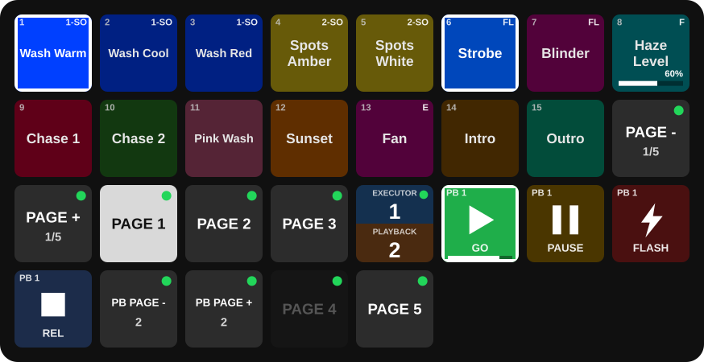

# MagicQ Deck

**Controla ChamSys MagicQ desde un Elgato Stream Deck.** Cada tecla se dibuja sola con el nombre y el color del
executor de MagicQ que controla, sigue las páginas y se ilumina cuando el botón o el playback está activo.

[🇬🇧 English](README.md) · 🇪🇸 Español



> Proyecto comunitario no oficial. No está hecho, respaldado ni soportado por ChamSys ni por Elgato.
> "MagicQ" y "ChamSys" son marcas de ChamSys Ltd.; "Stream Deck" es una marca de Corsair Memory, Inc.

## Qué hace

- **Executors por número.** Pon una tecla *Executor* en el deck y muestra el **nombre y el color** del botón, leídos
  del archivo del show de MagicQ. Guarda en MagicQ y las teclas se actualizan solas.
- **Conoce cada tipo de botón.** Botón, **Button (SOLO)** con sus grupos (al activar uno se apagan los demás),
  **Flash** (activo mientras mantienes la tecla), **Fader** (0 % / 100 %) y **Encoder** (sube / baja, se repite mientras se mantiene).
- **Páginas.** *Página +*, *Página −*, *Ir a página* y una tecla *Indicador de página* para el Execute Window.
- **Playbacks 1–10.** Teclas *Play*, *Pausa*, *Release* y *Flash* que se iluminan mientras el playback está en marcha,
  y *Playback Página +/−*.
- **Estado en vivo.** Usa el feedback OSC de MagicQ para mostrar qué está activo. Tus propias pulsaciones se ven al instante.
- **Avisa si MagicQ está cerrado.** Las teclas se atenúan con una franja roja hasta que vuelve.
- **Tecla de configuración.** Cambia la IP de MagicQ y los puertos OSC desde el propio Stream Deck, sin editar archivos.
- **Inglés y español.** Los menús del plugin, los textos de las teclas y los paneles de ajustes siguen el idioma de Stream Deck.

## Requisitos

- **Windows 10 / 11** y el **software de Stream Deck 6.9 o superior** (desarrollado con la 7.6).
  Sirve cualquier Stream Deck con teclas (probado en un Stream Deck XL, 32 teclas).
- **MagicQ PC** (también cuando lo maneja un Mini Connect u otro wing). Hace falta que el OSC esté disponible: según el manual
  de ChamSys, en MagicQ PC el OSC solo funciona con el programa completamente desbloqueado. Desarrollado y probado con MagicQ 1.9.8.
- MagicQ y Stream Deck deben estar en el **mismo ordenador**, porque el plugin lee el archivo del show del disco.
  (La parte de OSC también funciona por red.)

## Instalación

1. Descarga **`com.foxy.magicqdeck.streamDeckPlugin`** de la [última versión](../../releases/latest).
2. **Haz doble clic.** El software de Stream Deck te pide instalar el plugin. Acepta.
3. En la lista de acciones de Stream Deck aparece una categoría nueva, **MagicQ**.

## Configurar MagicQ (una vez)

En MagicQ abre **Setup → View Settings → Network** y pon:

| Ajuste | Valor |
|---|---|
| Modo OSC | **Tx y Rx** |
| Puerto OSC **Rx** | `8000` |
| Puerto OSC **Tx** | `9000` |
| IP de transmisión OSC | `127.0.0.1` (MagicQ y Stream Deck en el mismo PC) |

> **Si usas VRChat:** el OSC de VRChat usa el puerto 9000. Usa otro número para el puerto Tx, por ejemplo `9100`,
> y escribe el mismo número en la tecla *Configuración MagicQ* (abajo).

## Primeros pasos

1. Arrastra la acción **Configuración MagicQ** a una tecla. Los valores por defecto coinciden con la tabla de arriba.
   Cuando el puntito de la tecla está en **verde**, MagicQ responde. En rojo, no (mira [Solución de problemas](#solución-de-problemas)).
2. Arrastra acciones **Executor** a las teclas. Si dejas vacío *Número de executor*, cada tecla toma el número de su
   posición en el deck (arriba a la izquierda = 1, luego de izquierda a derecha y de arriba abajo). O escribe el número que quieras.
3. Añade **Página +** y **Página −** (o **Ir a página**) para moverte por las páginas del Execute Window.
4. Añade teclas **Playback** (elige Play, Pausa, Release o Flash y el playback 1–10) y **Playback Página +/−**.
5. Opcional: una tecla **Indicador de página** muestra la página actual de Executor y de Playback.

## Las acciones

| Acción | Qué hace |
|---|---|
| **Executor** | Un botón del Execute Window por número. Dibuja su nombre, color y estado activo. Se comporta según su tipo. |
| **Página + / Página −** | Página siguiente / anterior del Execute Window (las que existen en tu show). Muestra `actual/última`. |
| **Ir a página** | Salta a una página concreta. Se resalta cuando es la actual. |
| **Playback** | Play (GO), Pausa, Release o Flash del playback 1–10. Play y Flash se iluminan mientras el playback está activo. |
| **Playback Página + / −** | Cambia la página de playbacks de MagicQ y muestra su número. |
| **Indicador de página** | Muestra la página de Executor, la de Playback, o las dos. |
| **Configuración MagicQ** | IP, puertos y archivo del show. El punto verde / rojo indica el enlace; al pulsarla pide el estado otra vez. |

### Tipos de botón y colores

El plugin lee de tu show el tipo y el color de cada botón:

| En MagicQ | En la tecla | Al pulsarla |
|---|---|---|
| Button | nombre, color | alterna (un solo *activar*, como un clic de ratón) |
| Button (SOLO) | etiqueta `n-SO` | lo activa y apaga el resto de su grupo SOLO |
| Flash | etiqueta `FL` | activo solo mientras mantienes la tecla |
| Fader | etiqueta `F`, barra de nivel | alterna 0 % / 100 % |
| Encoder | etiqueta `E +` / `E −` | sube / baja mientras se mantiene (la dirección se elige en el panel de la tecla) |
| Funciones especiales (Div / Tap / Inc / Dec SP…) | rojo | como un botón |

Se reproducen los colores de botón 0–10 de MagicQ (azul, rojo, verde, cian, magenta, naranja, rosa, marrón, amarillo, verde mar).
Un valor desconocido se dibuja en azul.

## Conviene saber (límites)

- **El estado se refresca cada ~3 segundos.** MagicQ solo envía su volcado de estado OSC a ese ritmo y no anuncia los
  cambios hechos por OSC. Por eso el plugin actualiza la tecla en el momento de pulsarla y deja que el siguiente informe
  de MagicQ la corrija. Lo que cambie en otro sitio (ratón, consola) puede tardar hasta 3 s en verse.
- **La página de playbacks la cuenta el plugin.** MagicQ no la publica por OSC, así que si la cambias en la consola
  el número del deck se puede desfasar. Cambiándola desde el deck se mantiene bien.
- **El OSC solo llega a los playbacks 1–10 y a las páginas 1–10 del Execute Window** (limitación de ChamSys en las
  direcciones OSC integradas). Un show con más de 10 páginas de executes se puede *mostrar*, pero las páginas por encima de 10 no se pueden pulsar por número.
- **No disponible por OSC, por eso no está incluido:** ALT / SHIFT, XFADE, estado de ADD/SWAP, estado del blackout.
- Los grupos SOLO se suponen dentro de una misma página. Solo Windows (macOS sin probar).

## Solución de problemas

- **Punto rojo / teclas atenuadas.** El plugin no recibe respuesta de MagicQ. Comprueba que MagicQ está abierto, que el modo
  OSC es *Tx y Rx*, que los puertos coinciden con la tecla *Configuración MagicQ* (el puerto de **envío** del plugin es el
  puerto **Rx** de MagicQ, y el puerto de **escucha** del plugin es el puerto **Tx** de MagicQ) y que ningún cortafuegos bloquea UDP.
  En MagicQ PC, el OSC necesita que esté desbloqueado.
- **Las teclas solo muestran un número.** No se encontró el archivo del show. En *Configuración MagicQ* deja *Archivo del show* en `auto`,
  o pega la ruta completa de tu `.shw`. MagicQ tiene que haber guardado el show al menos una vez en `Documentos\MagicQ\show`.
- **Puerto en uso.** Otro programa (por ejemplo VRChat) usa el puerto de escucha. Elige otro en MagicQ y en la tecla *Configuración MagicQ*.
- **Registros.** `%APPDATA%\Elgato\StreamDeck\Plugins\com.foxy.magicqdeck.sdPlugin\logs`.

## Compilar desde el código

```bash
npm install
npm test          # pruebas unitarias
npm run pack      # genera dist/com.foxy.magicqdeck.streamDeckPlugin
```

Para desarrollar en Windows, `scripts/install-dev.ps1` enlaza la carpeta del plugin en Stream Deck, de modo que una recompilación
se recoge al reiniciar el plugin. En [cómo funciona](docs/como-funciona.es.md) tienes el formato del archivo del show y lo descubierto sobre OSC.

## Contribuir

Se agradecen issues y pull requests, sobre todo: soporte para macOS, más tipos de botón y de color, e informes de otras versiones de
MagicQ. Indica qué versiones de MagicQ y de Stream Deck usas.

## Licencia

[MIT](LICENSE)
