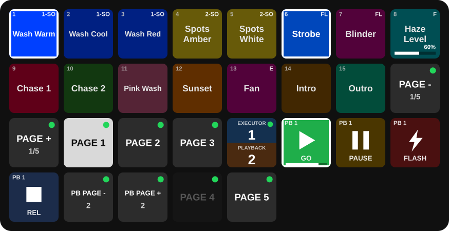

# MagicQ Deck

**Control ChamSys MagicQ from an Elgato Stream Deck.** Every key draws itself with the name and colour of the
MagicQ executor it controls, follows pages, and lights up when the button or playback is active.

🇬🇧 English · [🇪🇸 Español](README.es.md)



> Unofficial community project. It is not made, endorsed or supported by ChamSys or Elgato.
> "MagicQ" and "ChamSys" are trademarks of ChamSys Ltd.; "Stream Deck" is a trademark of Corsair Memory, Inc.

## What it does

- **Executors by number.** Put an *Executor* key on the deck and it shows the button's **name and colour**, read
  from the MagicQ show file. Save in MagicQ and the keys update on their own.
- **Knows every button type.** Button, **Button (SOLO)** with its groups (activating one turns the others off),
  **Flash** (held while the key is held), **Fader** (0 % / 100 %) and **Encoder** (raise / lower, repeats while held).
- **Pages.** *Page +*, *Page −*, *Go to page* and a *Page indicator* key for the Execute Window.
- **Playbacks 1–10.** *Play*, *Pause*, *Release* and *Flash* keys that light up while the playback is running,
  plus *Playback Page +/−*.
- **Live state.** Uses MagicQ's OSC feedback to show what is active. Your own presses show instantly.
- **Notices when MagicQ is closed.** Keys are dimmed with a red strip until it comes back.
- **Settings key.** Change MagicQ's IP and the OSC ports from Stream Deck, no files to edit.
- **English and Spanish.** Plugin menus, key texts and settings panels follow the Stream Deck language.

## Requirements

- **Windows 10 / 11** and the **Stream Deck software 6.9 or newer** (developed on 7.6).
  Any Stream Deck with keys works (tested on a Stream Deck XL, 32 keys).
- **MagicQ PC** (also when it is driven by a Mini Connect or another wing). OSC must be available: per the ChamSys manual,
  OSC works on MagicQ PC only when it is fully unlocked. Developed and tested with MagicQ 1.9.8.
- MagicQ and Stream Deck must run on the **same computer**, because the plugin reads the show file from disk.
  (The OSC part also works over the network.)

## Install

1. Download **`com.foxy.magicqdeck.streamDeckPlugin`** from the [latest release](../../releases/latest).
2. **Double-click it.** The Stream Deck software asks to install the plugin. Accept.
3. In the Stream Deck action list you will find a new **MagicQ** category.

## Set up MagicQ (once)

In MagicQ open **Setup → View Settings → Network** and set:

| Setting | Value |
|---|---|
| OSC mode | **Tx and Rx** |
| OSC **Rx** port | `8000` |
| OSC **Tx** port | `9000` |
| OSC Tx IP | `127.0.0.1` (MagicQ and Stream Deck on the same PC) |

> **VRChat users:** VRChat's own OSC uses port 9000. Use another number for the Tx port, for example `9100`,
> and type the same number in the *MagicQ Settings* key (below).

## First steps

1. Drag the **MagicQ Settings** action onto a key. Defaults match the table above. When the little dot on the key is
   **green**, MagicQ is answering. Red means it is not (see [Troubleshooting](#troubleshooting)).
2. Drag **Executor** actions onto the keys. If you leave *Executor number* empty, each key takes the number of its
   position on the deck (top-left = 1, then left to right, top to bottom). Or type any number.
3. Add **Page +**, **Page −** (or **Go to page**) to move through the Execute Window pages.
4. Add **Playback** keys (choose Play, Pause, Release or Flash and the playback 1–10) and **Playback Page +/−**.
5. Optional: a **Page indicator** key shows the current Executor and Playback pages.

## The actions

| Action | What it does |
|---|---|
| **Executor** | A button of the Execute Window by number. Draws its name, colour and active state. Behaves according to its type. |
| **Page + / Page −** | Next / previous Execute Window page (the pages that exist in your show). Shows `current/last`. |
| **Go to page** | Jumps to a given page. Highlighted when it is the current one. |
| **Playback** | Play (GO), Pause, Release or Flash of playback 1–10. Play and Flash light up while the playback is active. |
| **Playback Page + / −** | Changes MagicQ's playback page and shows its number. |
| **Page indicator** | Shows the Executor page, the Playback page, or both. |
| **MagicQ Settings** | IP, ports and show file. Green / red dot shows the link state; pressing it asks for the state again. |

### Button types and colours

The plugin reads each button's type and colour from the show:

| In MagicQ | On the key | Pressing it |
|---|---|---|
| Button | name, colour | toggles (one *activate*, like a mouse click) |
| Button (SOLO) | `n-SO` tag | activates it and turns off the rest of its SOLO group |
| Flash | `FL` tag | active only while the key is held |
| Fader | `F` tag, level bar | toggles 0 % / 100 % |
| Encoder | `E +` / `E −` tag | raises / lowers while held (choose the direction in the key's panel) |
| Special functions (Div / Tap / Inc / Dec SP…) | red | like a button |

MagicQ's button colours 0–10 are reproduced (blue, red, green, cyan, magenta, orange, pink, brown, yellow, sea green).
Unknown values fall back to blue.

## Good to know (limits)

- **State refreshes every ~3 seconds.** MagicQ only sends its OSC state dump at that rate, and it does not announce
  changes made through OSC. The plugin therefore updates the key the moment you press it and lets MagicQ's next
  report correct it. Changes made somewhere else (mouse, console) can take up to 3 s to show.
- **The playback page is counted by the plugin.** MagicQ does not report it over OSC, so if you change the playback
  page on the console the number on the deck can drift. Changing it from the deck keeps it right.
- **OSC only reaches playbacks 1–10 and Execute Window pages 1–10** (ChamSys limitation of the built-in OSC
  addresses). A show with more than 10 execute pages can be *displayed*, but pages above 10 cannot be pressed by number.
- **Not available through OSC, so not included:** ALT / SHIFT, XFADE, ADD/SWAP state, blackout state.
- SOLO groups are assumed to belong to one page. Windows only (macOS untested).

## Troubleshooting

- **Red dot / dimmed keys.** The plugin gets no answer from MagicQ. Check that MagicQ is running, that OSC mode is
  *Tx and Rx*, that the ports match the *MagicQ Settings* key (the plugin's **send** port is MagicQ's **Rx** port, and
  the plugin's **listen** port is MagicQ's **Tx** port) and that no firewall blocks UDP. On MagicQ PC, OSC needs it to be unlocked.
- **Keys show only a number.** The show file was not found. In *MagicQ Settings* leave *Show file* as `auto`, or paste the full
  path to your `.shw`. MagicQ must have saved the show at least once in `Documents\MagicQ\show`.
- **Port already in use.** Another program (for example VRChat) is using the listen port. Pick another one in MagicQ
  and in the *MagicQ Settings* key.
- **Logs.** `%APPDATA%\Elgato\StreamDeck\Plugins\com.foxy.magicqdeck.sdPlugin\logs`.

## Build from source

```bash
npm install
npm test          # unit tests
npm run pack      # builds dist/com.foxy.magicqdeck.streamDeckPlugin
```

For development on Windows, `scripts/install-dev.ps1` links the plugin folder into Stream Deck so a rebuild is picked
up after the plugin restarts. See [how it works](docs/how-it-works.md) for the show-file format and the OSC findings.

## Contributing

Issues and pull requests are welcome, especially: macOS support, more button/colour types, and reports from other
MagicQ versions. Please say which MagicQ and Stream Deck versions you use.

## License

[MIT](LICENSE)
